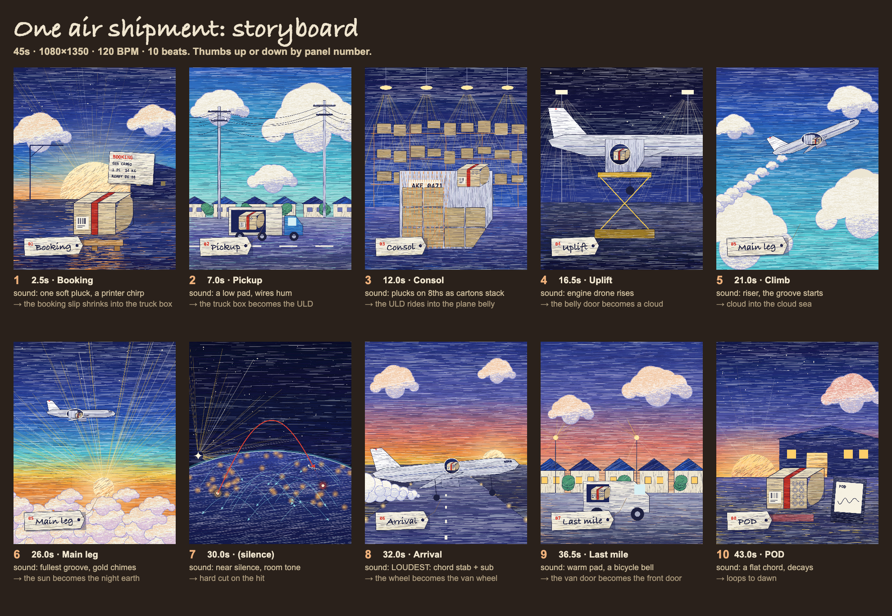

# claude-motion

Videos where every frame is JavaScript. Claude writes code that draws each pencil stroke on one canvas, then a headless browser and ffmpeg render it to MP4.



The engine is the [animate](https://github.com/cth9191/animate) skill for Claude Code by cth9191 (MIT). This repo adds two things on top of it.

- `styles/ballpoint/` is a drawing style. Dense horizontal pencil strokes, cream cumulus with lavender shading, thin dark lines for structures, gold light. The look is inspired by [Kevin Ngo's](https://x.com/kevin_t_ngo) Canon in D video.
- `styles/REFERENCES.md` lists nine more looks from Kevin Ngo's posts, each with what kind of piece it suits and how to build it here. Name one in your prompt to use it.
- `pieces/air-shipment/` is a 45s, 4:5 piece. One air shipment goes from booking to POD. A carton with a red band collects a stamp at every hand-off. Red marks the shipment and nothing else.

## Make your own

You need Claude Code, Node 18+ and ffmpeg.

1. Install the skill in Claude Code.
   ```
   /plugin marketplace add cth9191/animate
   /plugin install animate@animate
   ```
2. Install the browser the renderer uses.
   ```bash
   npx playwright install chromium
   ```
3. Clone this repo and open Claude Code inside it.
   ```bash
   git clone https://github.com/harshpuri84/claude-motion && cd claude-motion
   ```
4. Ask for a video. For example: "Use the animate skill with the ballpoint style. Make a 30s video about how a coffee bean gets to my cup."

The skill asks a few questions, then stops twice for your approval: once for the story, once for the storyboard. It renders nothing until you approve the board.

## Look at the piece

Open `pieces/air-shipment/index.html` in a browser. The canvas draws live.

To render the storyboard yourself, run this from the repo root. `$SKILL` is the folder where the animate skill is installed.

```bash
node $SKILL/tools/build.mjs pieces/air-shipment && node $SKILL/tools/storyboard.mjs pieces/air-shipment
```

To render the full video with its score (about 4 minutes on a laptop), run this. The MP4 lands in `pieces/air-shipment/renders/share.mp4`.

```bash
node $SKILL/tools/export.mjs pieces/air-shipment --share
```

## Notes

- If `npm i -g playwright` fails with `EEXIST`, you probably have Python Playwright installed. Run `npm i playwright` inside the skill folder instead.
- Put your own reference videos in `references/`. Git ignores that folder, so other people's work stays on your machine.
- `pieces/air-shipment/index.html` is a build output. It bundles kit code from animate, Copyright (c) 2026 cth9191, under the MIT License.
