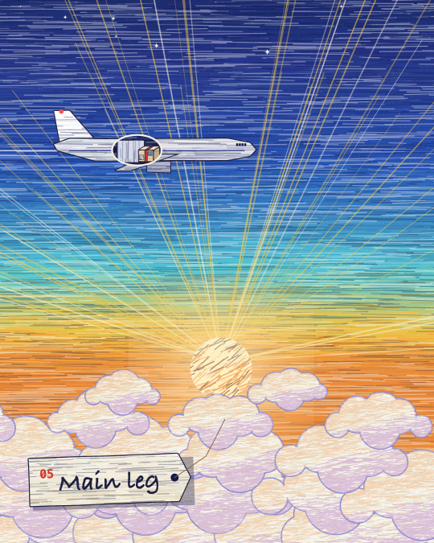

# Ballpoint

Dense coloured-pencil and ballpoint strokes, mostly horizontal, in layered blues. Cream cumulus with lavender shading. Thin dark lines for structures such as poles, wires and aircraft. Warm gold light, orange city glow at night. Matched from Kevin Ngo's Canon in D video (stills measured with `tools/measure/refs.mjs`).

## Palette

`BP` in `kit.js`. Night navy `#151a48`, ink blue `#283888`, blue `#2b58b9`, mid `#3995cb`, cyan `#57cad6`, ice `#96dad6`, cream `#ece6d3`, lavender `#8d8fd0`, peach `#f0b98a`, orange `#ef8f3c`, gold `#f2c84b`, line `#1d2040`. **Red `#d4382c` is reserved for the one thing the story follows** (in `air-shipment`, the carton's band and its route).

## The medium

- `bpStrokes(x0, y0, x1, y1, stops, o)`: the core texture. Thousands of long, nearly flat strokes whose colour follows a vertical gradient (`stops = [[y, '#hex'], ...]`), with random lighter and darker strokes mixed in. `per` sets density, `a` the angle, `len` the stroke length.
- `bpSky(stops)`: full-bleed sky. `bpFill(P, stops)`: any shape filled with strokes, plus a crisp outline.
- `bpCloud(cx, cy, s, key, o)`: cumulus from overlapping bumps, lavender shading toward the bottom right, `warm` adds a peach rim on the lit side.
- `bpSun`, `bpRays`, `bpStars`, `bpGlobe` (night earth with city glow), `bpArc` (route arcs).
- Props: `bpPlane` (side-view freighter, `gear`, `lights`), `bpTruck`, `bpULD` (AKE container), `bpHouse`, `bpTree`, `bpPole`, `bpWire`.
- Hero: `bpCarton(x, y, s, { stamps })`, a cream carton with a red band, a barcode label and one stamp per hand-off.
- Caption: `bpTag(num, word)`, a shipping tag on a string, lower left.

## Motion habits

- On 2s. Strokes re-jitter every boil step, so held frames stay alive.
- Shape morphs between worlds (`kit/morph.js`); the window is a clean cream-rimmed hole.
- Slow push-ins on the payoff shots.

## Frame checklist (on top of grammar/FRAME.md)

1. **Every surface is strokes.** No flat fills except tag paper and window glass.
2. **Strokes run mostly horizontal.** Tilt them only for a reason (a rotating tyre, a sun's surface).
3. **Structures are thin, dark and crisp** (`bpLine`, width about 2). The strokes carry the colour, the lines carry the shape.
4. **Red appears once per frame, on the hero only.**
5. **Sky has three or more gradient stops**, and the light source has gold rays.

## Not matched

- The reference's longer, more painterly sky strokes at full 4K detail. At 1080 wide, `per: 120` is a compromise between texture and render time (about 160 ms per frame).

## Proven on

`pieces/air-shipment` in [claude-motion](https://github.com/harshpuri84/claude-motion): 45s, 4:5, 10 worlds, 8 morphs, one hard cut.
